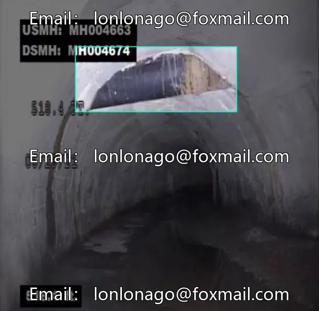
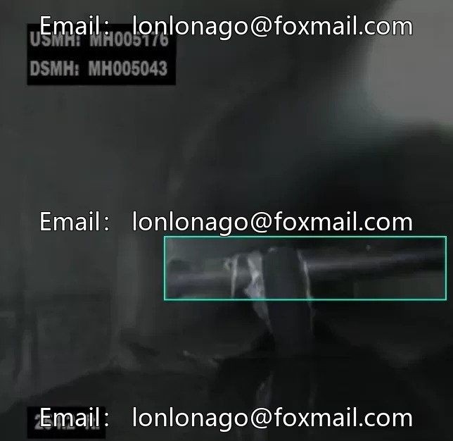
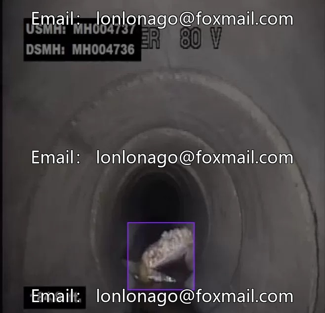
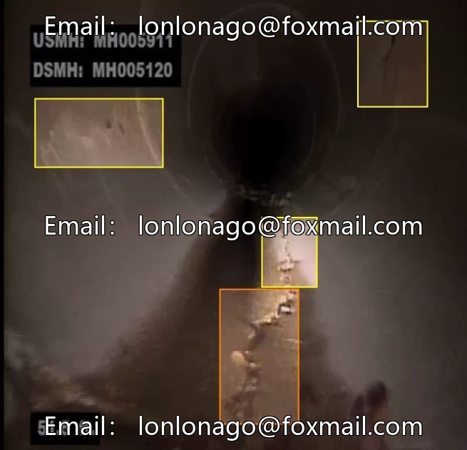

# Intelligent image recognition and deep learning for defect detection in sewage pipelines and drainage pipes, including images of cracks, obstacles, etc.

## Body

Submerged Pipeline and Drainage System Defects Intelligent Image Crack, Obstacle Recognition Deep Learning Dataset
Issue 10115, Computer Vision Object Detection Dataset, Focuses on Sinkhole Defect Detection Scenario
Containing 978 images, 7 defect categories (bending, crack, fragmentation, hole, joint offset, obstruction, public facility intrusion), along with one related dataset.
The data is formatted as image files suitable for training and testing of target detection algorithms, supporting model development and testing.
The volume of the dataset is sufficient, with detailed classification, which can enhance the efficiency of pipeline health monitoring and fault early warning, reducing the cost of manual inspection.
Virtual material, once sold, will not be returned.
Interested friends, click "I want" to proceed.

## Images

## Payment

Here is a pay link on Stripe ( https://buy.stripe.com/3cs8yP7sY87d0vu9AB ). Please contact me lonlonago@foxmail.com after funding $89, and I will send you a complete data files , thank you!

